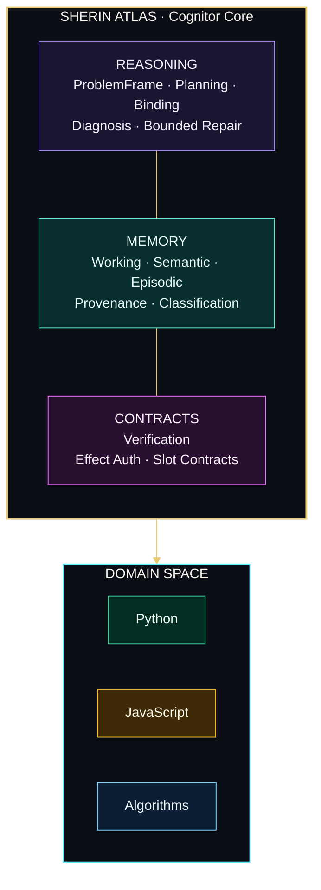
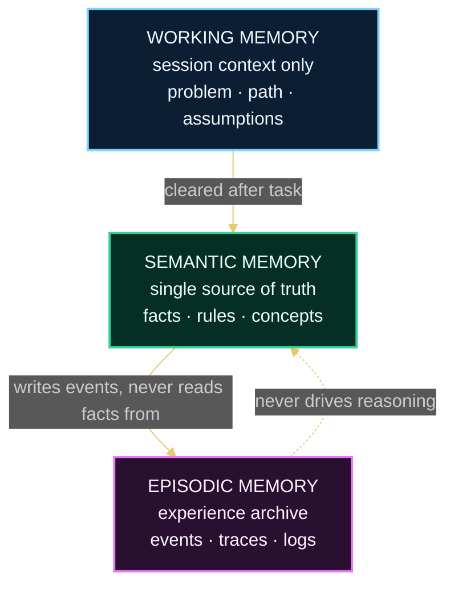
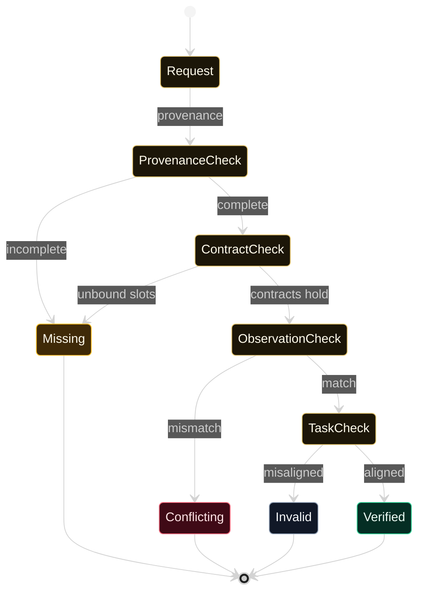
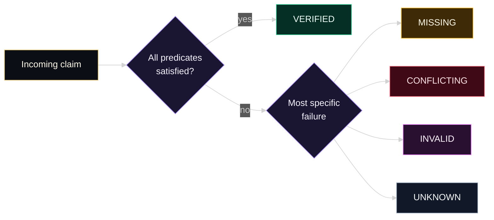
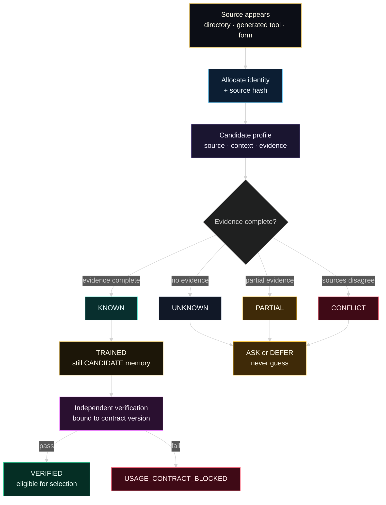
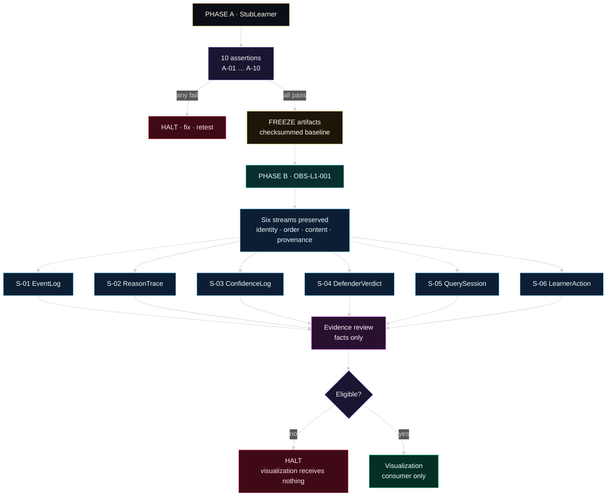

<div align="center">

# 🧠 SHERIN ATLAS

### Deterministic Reasoning Engine
**Kulexicon handles language. SHERIN handles meaning.**

[](https://github.com)
[](docs/architecture)
[](docs/contracts)
[](LICENSE)

<br>

**A formal, non-hallucinating reasoning engine that never invents answers.**  
Every claim carries provenance. Every result requires independent verification.  
Unknown information stays unknown.

</div>

---

## ✨ Why Sherin Atlas Exists

Most modern AI systems predict the next token.  
When information is missing, they fabricate.

**Sherin Atlas works differently.**

| Traditional Approach | Sherin Atlas |
|----------------------|--------------|
| Predicts probable answers | Constructs answers only from verified primitives |
| Hallucinates on incomplete data | Preserves `UNKNOWN` / `MISSING` states |
| Self-reinforcing (can learn its own mistakes) | Independent verification required before knowledge promotion |
| Opaque reasoning | Full provenance + explicit diagnosis + bounded repair |
| Language-tied | Language-independent Cognitor core + domain adapters |

> **Core Loop**  
> `Teach → Parse → Defend → Store → Observe → Test → Update`

---

## 🏗 Architecture Overview



### Layer Responsibilities

| Layer | Component | Critical Rule |
|-------|-----------|---------------|
| **Language** | Kulexicon Adapter | Text ↔ KUID conversion. Read-only dictionary. |
| **Input Guard** | Defender Engine | Nothing enters the Knowledge Base without validation |
| **State Monitor** | Observe Engine | Records *every* event with provenance |
| **Knowledge** | Semantic Memory | Facts, Rules, Concepts — immutable once verified |
| **Reasoning** | Reasoner + Planner | Forward/backward chaining + multi-hop + diagnosis |
| **Learning** | Curriculum + Learner | Staged progression + checkpoint + rollback |
| **Orchestration** | SherinEngine | Thin coordinator — no business logic |

---

## 🧩 Memory Architecture

Sherin maintains three strictly separated memory layers:



**Invariants**
- Semantic Memory is the single source of truth
- Episodic Memory never drives reasoning
- Working Memory never stores permanent knowledge
- Only `VERIFIED` items become eligible for task selection

---

## 🛡️ Core Safety Contracts

### Independent Verification (P1-D)

Every result must pass an independent acceptance contract before becoming knowledge.



```text
VerificationOutcome =
  | VERIFIED     { result, evidence }
  | MISSING      { slots }
  | CONFLICTING  { conflicts }
  | INVALID      { reasons }
  | UNKNOWN      { residual }
```

### Fail-Closed Gates



- Missing information → `MISSING` / `UNKNOWN`
- Conflicting evidence → `CONFLICTING`
- No silent invention. Ever.

Full gallery: [docs/architecture/diagrams.md](docs/architecture/diagrams.md)

---

## Specialized flows

### Curriculum stages

Stages are linear and gated. A stage cannot open until the previous checkpoint is frozen.

```mermaid
%%{init: {'theme':'dark','themeVariables': {'fontFamily':'Inter, ui-sans-serif, system-ui'}}}%%
flowchart LR
    S00["00 Foundation"] --> S01["01 Facts"]
    S01 --> S02["02 Chains"]
    S02 --> S03["03 Properties"]
    S03 --> S04["04 Rules"]
    S04 --> S05["05 Multi-hop"]
    S05 --> S06["06 Arithmetic"]
    S06 --> S07["07 Sequences"]
    S07 --> S08["08 Contradiction"]
    S08 --> S09["09 Planning"]
    S09 --> S10["10 Adversarial"]

    GATE["After every stage<br/>tests · accuracy · anomalies · freeze"]

    S00 -.-> GATE
    S05 -.-> GATE
    S10 -.-> GATE

    style S00 fill:#0c0e16,stroke:#e8c872,color:#fffbeb
    style S01 fill:#0c1e33,stroke:#7dd3fc,color:#f0f9ff
    style S02 fill:#0c1e33,stroke:#7dd3fc,color:#f0f9ff
    style S03 fill:#082f2e,stroke:#5eead4,color:#ecfeff
    style S04 fill:#082f2e,stroke:#5eead4,color:#ecfeff
    style S05 fill:#1a1530,stroke:#a78bfa,color:#f5f3ff
    style S06 fill:#1a1530,stroke:#a78bfa,color:#f5f3ff
    style S07 fill:#2a1030,stroke:#e879f9,color:#fdf4ff
    style S08 fill:#3f0a16,stroke:#fb7185,color:#ffe4e6
    style S09 fill:#3f2a08,stroke:#fbbf24,color:#fffbeb
    style S10 fill:#052e24,stroke:#34d399,color:#ecfdf5
    style GATE fill:#1c1608,stroke:#e8c872,color:#fffbeb
```



### Tool discovery lifecycle

Discovery records a candidate. It does not import, execute, or promote.



### Observation harness

Phase A must freeze before Phase B can open. Visualization never decides eligibility.



---

## 📁 Repository Structure

```text
sherin-atlas/
├── sherin/
│   ├── core/                       # Language-independent Cognitor
│   │   ├── reasoning/              # Planning, binding, diagnosis, repair
│   │   ├── memory/                 # Allocator, context, classifier, store
│   │   ├── interfaces/             # Domain adapter contracts
│   │   └── contracts/              # Verification contracts
│   │
│   ├── domains/
│   │   └── programming/
│   │       └── python/             # First domain adapter
│   │           ├── knowledge/      # Constructs, functions, types
│   │           ├── problems/       # Curriculum problems
│   │           ├── adapters/       # Knowledge / Execution / Verification
│   │           └── execution/      # Sandbox
│   │
│   ├── curriculum/                 # Ingestion, generation, verification
│   └── tools/                      # Controlled runtime tools
│
├── docs/
│   ├── architecture/               # System design
│   ├── memory/                     # Memory classification system
│   ├── contracts/                  # Verification & training contracts
│   └── curriculum/                 # Staged learning protocol
│
├── examples/                       # End-to-end demonstrations
├── tests/                          # Fail-closed test suites
└── assets/                         # Diagrams & visuals
```

---

## 🚀 Quick Start

```bash
# Clone
git clone https://github.com/your-org/sherin-atlas.git
cd sherin-atlas

# Create environment
python -m venv .venv
source .venv/bin/activate          # or .venv\Scripts\activate on Windows

# Install
pip install -e ".[dev]"

# Run self-health + Level-1 verification suite
python -m sherin.tools.self_cycle
```

---

## 🧪 Current Status (Level-1)

| Capability | Status |
|------------|--------|
| Independent Verification Contract | ✅ Implemented |
| Provenance tracking | ✅ Implemented |
| Fail-closed on MISSING / CONFLICTING | ✅ Implemented |
| Bounded Local Repair (sketch) | ✅ Implemented |
| Self-health / self-validate loop | ✅ Implemented |
| Domain Adapter interfaces | ✅ Defined |
| Python domain (constructs + functions) | 🟡 In progress |
| Complex DAG composition | 🔜 Planned |
| Full curriculum stages 00–10 | 🔜 Planned |

---

## 📚 Documentation

- [Architecture Overview](docs/architecture/README.md)
- [Diagram Gallery](docs/architecture/diagrams.md)
- [Memory Classification System](docs/memory/README.md)
- [Independent Verification Contract](docs/contracts/verification.md)
- [Curriculum Protocol](docs/curriculum/README.md)
- [Domain Adapter Guide](docs/architecture/domain_adapters.md)

---

## 🎯 Design Principles

1. **Never invent** — preserve `UNKNOWN` and `MISSING`
2. **Provenance is mandatory** — every fact carries its source
3. **Verification before promotion** — no self-teaching of mistakes
4. **Core is language-independent** — domains supply syntax & execution
5. **Fail closed** — gates stay closed until evidence opens them
6. **Small, verifiable milestones** — teach → test → checkpoint → proceed

---

## 🗺️ Roadmap Snapshot

- [x] Core typed ports & verification outcomes
- [x] Independent Verification Contract (P1-D)
- [x] Self-health / self-repair demonstration
- [ ] Effect Authorization (P1-E)
- [ ] Bounded Local Repair (P2-C) production hardening
- [ ] Full Python domain adapter
- [ ] Curriculum Stages 00–10
- [ ] Multi-domain concept registry
- [ ] Observation Harness (OBS-L1-001)

---

<div align="center">

**Built for truth-seeking systems.**  
No hallucinations. Full provenance. Independent verification.

[Documentation](docs/) · [Examples](examples/) · [Contributing](CONTRIBUTING.md)

</div>
