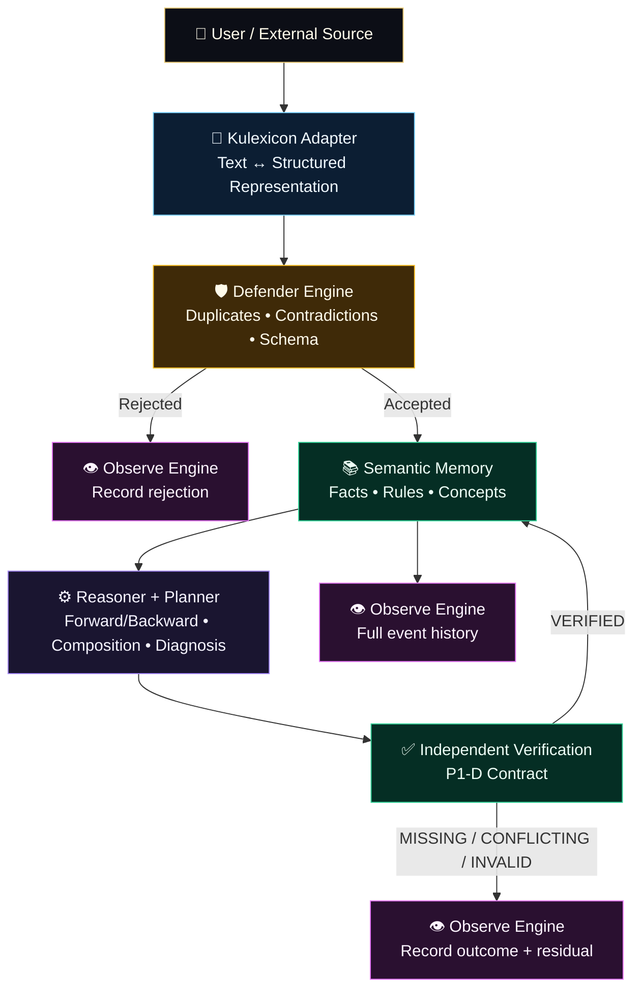
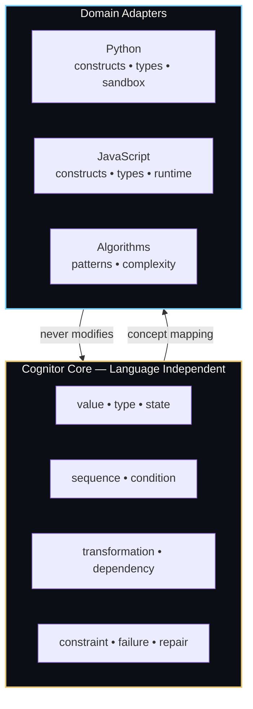
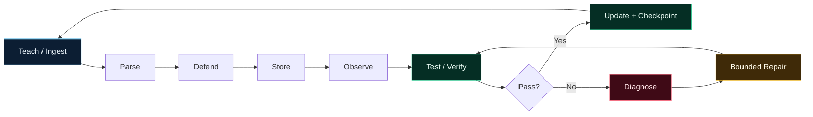

# Architecture — Sherin Atlas

Palette and the specialized flows live in [diagrams.md](diagrams.md).

## Philosophy

> **Kulexicon handles language. SHERIN handles meaning.**

Everything inside SHERIN operates on structured, typed units (KUID chunks / Knowledge Candidates).  
Raw text never becomes knowledge. Every promotion requires independent verification.

## High-Level Data Flow

## Cognitor Core vs Domain Adapters

The **Cognitor Core** is language- and domain-independent.  
It reasons about:

- value, type, state, sequence, condition, transformation
- dependency, constraint, input, output
- failure, cause, repair

**Domain Adapters** (Python, JavaScript, Algorithms, …) supply:

- concrete syntax / constructs
- type systems
- execution sandboxes
- verification oracles

Adding a new domain must never require changes to the core reasoning engine.

## Closed-Loop Reasoning

## Critical Invariants

1. Nothing enters Semantic Memory without passing Defender.
2. Episodic Memory never drives reasoning.
3. Only `VERIFIED` items are eligible for task selection.
4. Missing or conflicting information produces explicit `MISSING` / `CONFLICTING` / `UNKNOWN` states.
5. The system never invents values to fill gaps.
