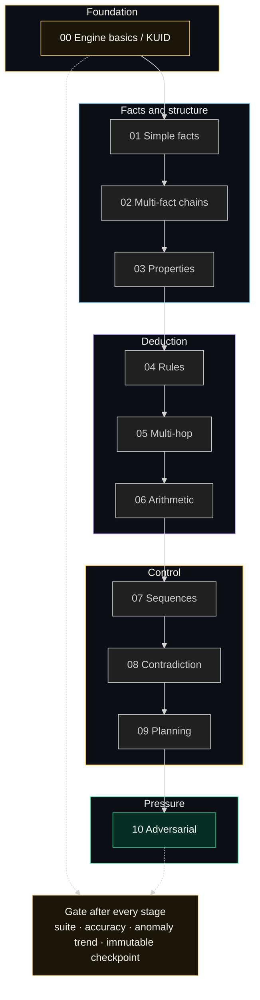
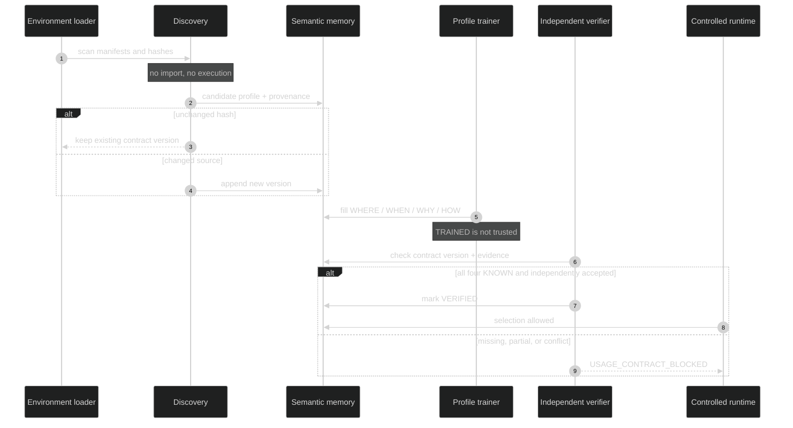
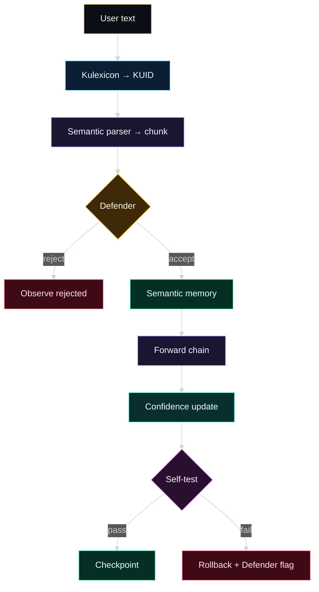

# Diagram gallery

One palette across every diagram.

| Token | Use | Hex |
| --- | --- | --- |
| Gold | identity, freeze, trained | `#e8c872` |
| Violet | reasoning and decisions | `#a78bfa` |
| Cyan | memory and streams | `#7dd3fc` |
| Teal | contracts and observation | `#5eead4` |
| Emerald | verified, eligible | `#34d399` |
| Amber | missing, partial, ask | `#fbbf24` |
| Rose | conflict, halt | `#fb7185` |
| Magenta | review, classification | `#e879f9` |
| Slate | unknown, invalid | `#94a3b8` |

Background fills stay near `#0c0e16`. Text stays `#f8f5ef` or the matching light tint. Do not mix the older indigo/purple set.

## Curriculum stages

Rollback is the only backward edge. A failed gate does not skip forward.

## Tool discovery lifecycle

Automatic discovery authorizes nothing: no install, no filesystem write, no network, no memory promotion.

## Observation harness

```mermaid
%%{init: {'theme':'dark','themeVariables': {'fontFamily':'Inter, ui-sans-serif, system-ui'}}}%%
flowchart LR
    subgraph A["Phase A · fail closed"]
        direction TB
        A1["A-01 Integrity"]
        A2["A-02 Isolation · state"]
        A3["A-03 Isolation · channels"]
        A4["A-04 Judge independence"]
        A5["A-05 Provenance · source"]
        A6["A-06 Provenance · chain"]
        A7["A-07 Event stream identity"]
        A8["A-08 Telemetry stream identity"]
        A9["A-09 Promotion blocked on fail"]
        A10["A-10 Pass results frozen"]
        A1 --> A2 --> A3 --> A4 --> A5 --> A6 --> A7 --> A8 --> A9 --> A10
    end

    subgraph B["Phase B · six streams"]
        direction TB
        E["Evidence · what happened"]
        G["Eligibility · does it meet the bar"]
        V["Visualization · read only"]
        E --> G --> V
    end

    A10 -->|all ten pass| FR["Freeze"]
    FR --> E
    A9 -->|any fail| HALT["Gate closed"]

    style A fill:#0c0e16,stroke:#e8c872,color:#fffbeb
    style B fill:#0c0e16,stroke:#5eead4,color:#ecfeff
    style FR fill:#1c1608,stroke:#e8c872,color:#fffbeb
    style HALT fill:#3f0a16,stroke:#fb7185,color:#ffe4e6
    style E fill:#0c1e33,stroke:#7dd3fc,color:#f0f9ff
    style G fill:#2a1030,stroke:#e879f9,color:#fdf4ff
    style V fill:#052e24,stroke:#34d399,color:#ecfdf5
```

Invariant: `PHASE A PASS → FREEZE → OBSERVATION → EVIDENCE REVIEW → ELIGIBILITY → VISUALIZATION`.

## Teaching path

