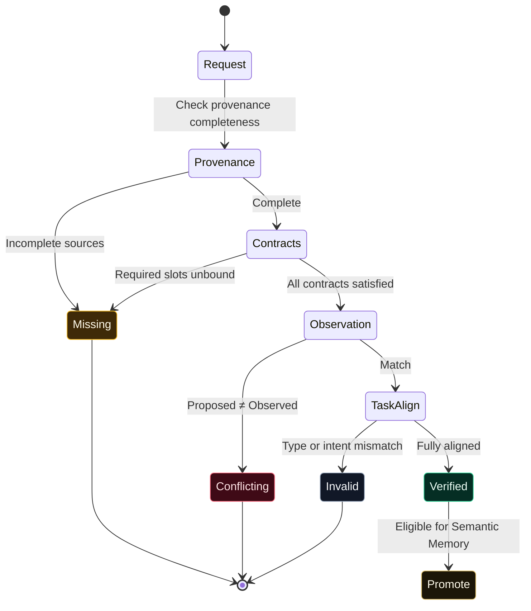

# Independent Verification Contract (P1-D)

## Purpose

Ensure that no result becomes durable knowledge until it has passed an independent acceptance contract. This is the primary anti-poisoning mechanism of Sherin Atlas.

## Contract Signature

```text
VerificationRequest = {
  task_context   : TaskContext,       # WHAT / WHICH / WHEN / WHY
  proposed       : Value | PartialAST,
  provenance     : SourceId[],
  operators_used : OperatorId[],
  observed       : Observation | None
}

VerificationOutcome =
  | VERIFIED     { result, evidence }
  | MISSING      { slots }
  | CONFLICTING  { conflicts }
  | INVALID      { reasons }
  | UNKNOWN      { residual }
```

## Decision Flow



## Acceptance Predicates

All must hold for `VERIFIED`:

1. **Provenance completeness** — every contributing leaf has an immutable SourceId.
2. **Contract satisfaction** — all required slots are BOUND or DERIVABLE; preconditions hold.
3. **Observation match** — independent re-execution (or oracle) agrees with the proposed result.
4. **Task alignment** — the result satisfies the original WHAT of the task.

## Rules

- The verifier is pure and side-effect-free.
- It never mutates the memory graph.
- Promotion to Semantic Memory is a separate step that only accepts `VERIFIED` outcomes.
- On failure the most specific non-VERIFIED state is returned.
- No silent invention is permitted under any circumstance.
